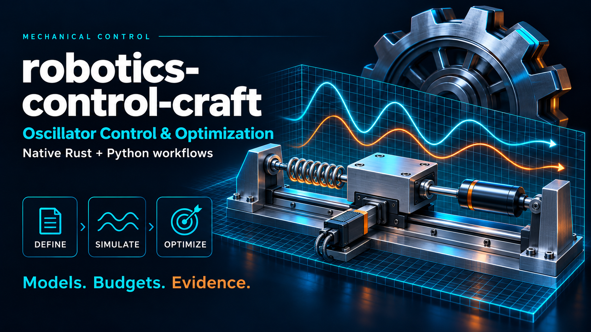

# robotics-control-craft 0.3.0

> **One of 18 related repositories.** The [repository overview](https://github.com/dietmarwo/fcmaes-rust/blob/main/docs/repositories.md) shows what each one does and how they connect.

A bounded research evaluator. See the [model card](docs/model.md) for units,
equations and supported behavior and the [user manual](docs/user-manual.md)
for the complete model and API reference with runnable examples. The
[tutorial](docs/tutorial.md) is a short walk-through, the
[architecture guide](docs/architecture.md) describes data flow and measured
performance, and [`examples/python/`](examples/python/README.md) contains
application and optimization scripts with recorded outputs. The
[0.1.0 implementation record](docs/implementation-0.1.0.md) preserves the
original scope; the performance logs record the 0.2.0 and 0.3.0 changes.

## Rust CLI and native examples

```sh
cargo run --release --locked -- describe
cargo run --release --locked -- run models/request.json
cargo run --release --locked --example sweep -- models/example.json
cargo run --release --locked --example matrix -- models/example.json
```

The CLI uses versioned JSON with exact model-byte SHA-256, candidate IDs and
explicit work and worker limits. `run -` accepts stdin. Exit 1 indicates a
rejected request. Exit 2 retains classified candidate records when at least
one candidate is incomplete or infeasible. Output traces are opt-in.

## Python

Install the matching wheel from `packages/` in a clean environment.
The tested wheel target is Linux x86-64 with a CPython 3.10+ ABI.
Actual clean-environment verification used CPython 3.12.

```python
from robotics_control_craft import Prepared, load_example

case = load_example()
prepared = Prepared(case["model"])
row = prepared.evaluate(case["parameters"], trace=True)
assert row["status"] == "complete"
print(row["score"])
scores, statuses, steps = prepared.score_matrix([[4, 2], [16, 5.5]])
print(scores, statuses, steps)
```

`Prepared.batch` and `Prepared.scores` cross into native code once per
batch with JSON candidates and records. `Prepared.score_matrix` takes a
numeric matrix and returns scores, statuses and steps without JSON, which
suits optimizers. Untraced candidates are integrated in lockstep vector
lanes; results are identical for every API, worker count and kernel.
The local Python campaign commits results to SQLite, preserves interrupted
attempts and reuses completed records by candidate, scenario, settings and
build identity. Fixed-work replay is scoped to the tested build.
Run `validation/run_campaign.py MODULE models/campaign.json campaign.sqlite`
with the installed package to evaluate or resume the included manifest.

## Verify and rebuild

```sh
cargo test --release --locked
cargo build --release --locked
python validation/validate.py ./target/release/robotics-control-craft
maturin sdist --out dist
maturin build --release --locked --out dist
```

Independent numerical scripts use Python 3.12. The oscillator oracle uses
NumPy 2.3.5 and SciPy 1.17.0. The optional
`validation/optimize.py robotics_control_craft` demonstrates an in-process SciPy DE objective.
The native examples need only the Rust crate. See `evidence/` for actual runs.
