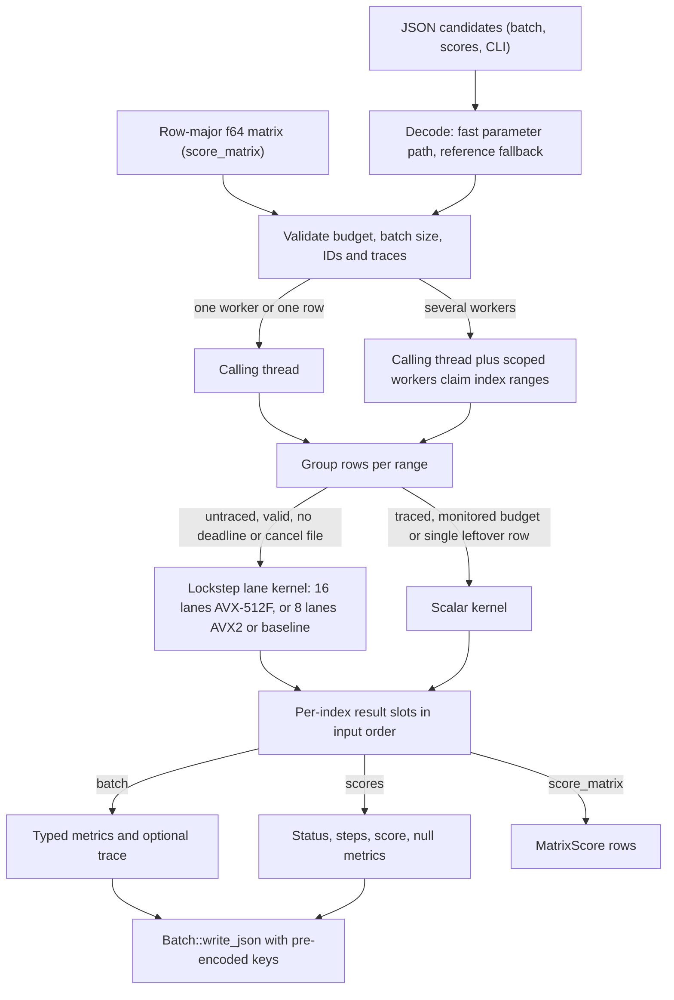

# Robotics Control Craft architecture

Version 0.3.0. Optimize sampled control and held actuation for a bounded
mass–spring–damper oscillator. The [user manual](user-manual.md) covers the
model reference and every API; this document describes how a call is
executed, the contracts between the parts and measured performance.

## Evaluation pipeline

| Boundary | Location | Responsibility |
| --- | --- | --- |
| Request and CLI | `src/main.rs`, `src/lib.rs` (`run`, `capabilities`), `models/request.json` | Versioned request schema, exact model-byte hash, typed validation, JSON output and exit code |
| Python boundary | `python/robotics_control_craft/__init__.py`, PyO3 module in `src/lib.rs` | Encode model and candidates once per call, release the GIL during native evaluation, decode the result envelope; `score_matrix` passes rows as `f64` lists and returns three lists |
| Prepared engine | `src/lib.rs` | Own the immutable domain model, decode candidates, enforce batch rules, dispatch rows, group untraced rows for the lane kernel, keep ordered results and encode JSON |
| Domain | `src/domain.rs` | Validate the model at preparation, check candidate parameters, integrate with the scalar or lane kernel, classify status and compute the minimization objective and metrics |
| Campaign | `python/robotics_control_craft/campaign.py` | Local SQLite replay, attempt journal and complete-result caching |
| Verification | `validation/`, `examples/`, `src/breakdown.rs`, `evidence/` | Independent oracle checks, executable examples, paired performance observations and phase timing |

## Data and execution contracts

### Preparation

`Prepared::new` hashes the exact model bytes with SHA-256, deserializes the
model (unknown fields are rejected) and validates its ranges, the declared
stability envelope and the control settings. It then caches the reciprocal
mass and detects AVX2 and AVX-512F support with
`is_x86_feature_detected!`, which selects the lane kernel for every later
call. The Python wrapper encodes models with sorted keys and compact
separators. Two inputs that differ in their serialized representation can
have different provenance hashes. Result and request schema tags remain at
0.1; the package version is reported separately.

### Batches and matrices

The JSON entry points (`evaluate_json`, `scores_json`, the CLI `run` and
the Python `batch`, `scores` and `evaluate`) validate candidate count
(1–4096), non-empty unique IDs of at most 128 bytes, parameter vector length
(up to 64), requested workers (1–64), `max_steps` (1–100,000,000), `wall_ms`
(1–86,400,000 when given) and the traced-candidate count (up to 16).
`scores_json` rejects traced candidates.

`Prepared::score_matrix(rows, parameters, budget)` is the typed entry point
added in 0.3.0. It takes `rows` untraced candidates stored row-major in one
`&[f64]`; each row has `parameters.len() / rows` values, and dimension 0 is
allowed. It rejects `rows` outside 1–4096, a length that is not a multiple
of `rows`, a dimension above 64 and an invalid budget. There are no IDs and
no duplicate check: rows are numbered by position. Budget JSON, limits,
dispatch, deadlines, cancellation and failure classification are those of
`scores_json`, and each `MatrixScore { status, steps, score }` equals the
lean record of the same parameters, with the score bit for bit. Unit tests
check this for invalid rows, `max_steps` limits, a cancel file and several
workers. The Python native method takes `Vec<Vec<f64>>` (ragged rows raise
`ValueError`), releases the GIL during evaluation and returns
`(scores, statuses, steps)` with NaN scores for non-complete rows. The
wrapper also accepts a 2-D NumPy array.

### Decoding

JSON candidate batches are decoded first with a twin of `Candidate` whose
`parameters` field is borrowed as a raw JSON slice. A single-pass parser
accepts only the strict JSON number grammar. Numbers with at most 19 digits,
a mantissa up to 2^53 and a decimal exponent within ±22 use one exact
multiply or divide (Clinger's fast path); other numbers use
`str::parse::<f64>`. Both round correctly, as serde_json's
`float_roundtrip` parser does, so the parsed values are identical. If the
fast decode fails for any reason (another JSON type, nesting, an infinite
value or any serde error), the batch is decoded again with the reference
types, so results and error messages are exactly the reference ones. The
CLI request uses the same scheme.

### Dispatch and lockstep grouping

With one worker or one row, the calling thread evaluates the whole batch.
Otherwise the calling thread and up to `workers - 1` scoped threads claim
index ranges through an atomic cursor. A range is one lane width long (16
rows with AVX-512F, 8 otherwise), and no more threads are started than
there are ranges. Each index owns a result slot written once, and output is
assembled in input order, so results do not depend on the worker count or
on which thread evaluated a range.

Within a range, when the budget has no `wall_ms` and no `cancel_file`,
untraced rows whose parameters pass the domain check are collected into a
lockstep group. A full group, or a final group of at least two rows, runs on
the lane kernel; unused lanes repeat the last row and are not reported. A
single leftover row, every traced row and every row under a monitored
budget use the scalar kernel. Rows that fail the parameter check are
reported immediately with 0 steps.

### Work, limits and cancellation

`Work` counts one logical step per RK4 step. Its fast branch handles
unmonitored steps below `max_steps`. Monitored steps check the cancel file
(a file-system `stat` per step), then the batch deadline (a clock read per
step), then the step budget. A lockstep group shares one counter because
all lanes advance on the same grid; a lane that fails keeps the count at
its failure, and the remaining lanes fail together at the step limit, which
gives each row the steps of the scalar kernel. Cancellation and deadlines
are cooperative. The wall clock can change which candidates finish, while
fixed-work replays agree independent of worker count. Candidate parallelism
creates scoped threads per call; concurrent callers should account for
total worker demand.

### Output

Full records contain typed metrics and any requested trace. Lean records
from `scores_json` and `Prepared.scores` have the same keys with null
metrics. Both keep the per-candidate limits, the diagnostics needed for
feasibility, numeric score checks and failure status. Matrix rows carry
only status, steps and score. `Batch::write_json` writes the envelope,
record and metrics keys, status strings, schema, version and the trace
column list as pre-encoded bytes in serde's field order; ids, details,
failure metrics, numbers and traces go through serde_json. A unit test
requires byte equality with `serde_json::to_string`. The metrics struct
declares its fields in alphabetical order, the order of the `Value` maps
that 0.2.0 produced. The CLI converts the same typed batch into a
`serde_json::Value`, whose maps also sort keys.

## Domain internals

The model is a bounded linear oscillator with `held` or `pd` control.
Preparation checks the ranges listed in the user manual, switch ordering,
the controller interval and the stability envelope
`dt × (sqrt(k/m) + c/m) ≤ 0.5`. Each candidate starts from the immutable
initial state with fresh counters.

The outer integration loop selects a force and the next control boundary:
the candidate's force for the segment (`held`), or the saturated PD force
from the state at the sample (`pd`). The inner RK4 loop advances position,
velocity and the integral of the squared tracking error, shortening the
step at control boundaries and the horizon. Squared force is constant over
a control interval; its RK4 weight is computed once per segment.

The scalar kernel is specialized by a const parameter for traced and
untraced candidates. A traced candidate reserves its trace for the expected
step count and fails as `invalid` on the step after its 10,000th trace row
(10,001 charged steps).

The lane kernel is generic over its width `N`. It keeps position,
velocity, error, effort, peak position and peak force as `[f64; N]` arrays
and performs, per lane, the scalar kernel's IEEE operations in the same
order; no operation is fused or reassociated, so every lane reproduces the
scalar result bit for bit. It is compiled three times: as the baseline
build (SSE2 on x86-64) and with the `avx2` target feature, both with eight
lanes, and with `avx512f` with sixteen lanes. Rust does not contract
multiplies and adds even when the target supports FMA. The per-step failure
test is masked by lane; a failing lane is classified exactly as in the
scalar kernel (non-finite state before the position limit). The effort
increment `h × weight / 6` is kept per lane and recomputed only when the
shared step `h` changes or a segment starts. A unit test compares the three
compiled kernels bit for bit, and another compares lockstep and scalar
records byte for byte for every batch size up to 19 rows of each control
kind, which covers full, padded and single leftover groups.

| Output | Computation or convention |
| --- | --- |
| Score | Terminal squared position error + 0.1 × terminal velocity squared + mean integrated tracking error + 0.001 × integrated force squared |
| Effort | Quadrature of the square of the held force |
| Peak position | Maximum absolute position at accepted grid endpoints, including the initial position |
| Trace | Post-step time, position, velocity and the force used for that step |

Limit events are checked at grid endpoints. The model contains no contact
or collision backend. The reciprocal mass introduced in 0.2.0 can change
the last few bits relative to a division. All 0.3.0 changes are
bit-identical with 0.2.0 on every benchmark workload, which the paired
checks confirmed byte for byte; validation keeps the independent
matrix-exponential check and the refined-step held-out replay.

## Changes in 0.3.0

| Round | Structural change |
| --- | --- |
| 1 | Typed `score_matrix` API in Rust and Python, a model-hash accessor and a shared dispatch helper |
| 2 | Lockstep RK4 lanes for untraced rows under unmonitored budgets; workers claim index ranges |
| 3 | AVX2 build of the lane kernel selected at preparation; eight lanes |
| 4 | Typed metrics struct instead of a `Value` map |
| 5 | Typed trace rows serialized directly and reserved up front |
| 6 | The calling thread is one of the batch workers |
| 7 | Lane kernel generic over its width; sixteen-lane AVX-512F build |
| 8 | Fast exact decoding of parameter arrays with reference fallback |
| 9 | Per-lane effort increment reused while the step repeats |
| 10 | Batch JSON writer with pre-encoded keys |

The [0.3.0 performance log](../robotics-control-craft-performance-log-0.3.0.md)
lists the timing of each round and one rejected attempt.

## Performance

All numbers in this section come from one host: 2 vCPUs, Intel(R) Xeon(R)
Processor @ 2.10GHz under KVM (AVX-512F available, so the sixteen-lane
kernel was active), Rust 1.97.0 and CPython 3.12.3. Four other projects
shared the host; every timing ran under a shared CPU lock, but background
load still varied, so differences below about 5% are within noise. None of
these numbers is comparable with the 0.2.0 log, which was measured on
another host.

### 0.2.0 to 0.3.0

Paired runs of the 0.2.0 baseline benchmark binary and the round 10 binary
(`validation/performance_pair.py --samples 11`, alternating order, model
preparation and process start excluded). Times are medians per prepared
call. The `parallel` workload keeps its four workers on this 2-vCPU host.
The matrix rows compare 0.2.0 lean scores (0.2.0 has no matrix API) with
0.3.0 `score_matrix`. Evidence: `evidence/performance-0.3.0/cumulative/`.

| Workload | API | 0.2.0 ms | 0.3.0 ms | 0.2.0 / 0.3.0 |
| --- | --- | ---: | ---: | ---: |
| Single prepared evaluation | full | 0.0040 | 0.0031 | 1.32x |
| 96 full records, one worker | full | 0.3549 | 0.0849 | 4.18x |
| 96 full records, four workers | full | 0.4450 | 0.1869 | 2.38x |
| 12 traced records | full | 0.2388 | 0.1012 | 2.36x |
| 1,024 invalid candidates | full | 1.3765 | 1.1183 | 1.23x |
| 48 domain cases (PD, 4,000 steps) | full | 6.1882 | 0.7384 | 8.38x |
| 48 secondary domain cases (held, 4,000 steps) | full | 6.3913 | 0.8587 | 7.44x |
| 96 lean scores | lean | 0.2203 | 0.0580 | 3.80x |
| 48 lean domain scores | lean | 6.2682 | 0.6744 | 9.29x |
| 48 lean secondary scores | lean | 6.1974 | 0.8306 | 7.46x |
| 96 matrix rows | lean → matrix | 0.2371 | 0.0306 | 7.75x |
| 48 matrix domain rows | lean → matrix | 6.3298 | 0.6165 | 10.27x |

### Time breakdown

`src/breakdown.rs` (an ignored test, run with
`cargo test --release --locked --lib breakdown -- --ignored --nocapture`)
times the phases of one call on the benchmark workloads: decode (candidate
and budget JSON), evaluate (validation, dispatch, kernels and record
construction) and encode (result JSON). Cells are medians of three runs.
Evidence: `evidence/performance-0.3.0/breakdown.json`.

| Workload | Rows | Mode | Decode µs | Evaluate µs | Encode µs | Total µs | µs per row |
| --- | ---: | --- | ---: | ---: | ---: | ---: | ---: |
| `one` | 1 | full | 0.27 | 2.12 | 0.38 | 2.79 | 2.786 |
| `one` | 1 | lean | 0.26 | 2.12 | 0.15 | 2.53 | 2.531 |
| `one` | 1 | matrix | – | – | – | 2.09 | 2.093 |
| `serial` | 96 | full | 15.36 | 34.56 | 25.25 | 75.19 | 0.783 |
| `serial` | 96 | lean | 15.38 | 32.07 | 5.21 | 53.52 | 0.557 |
| `serial` | 96 | matrix | – | – | – | 28.98 | 0.302 |
| `parallel` (4 workers) | 96 | full | 23.26 | 131.90 | 31.76 | 189.21 | 1.971 |
| `parallel` (4 workers) | 96 | lean | 22.40 | 115.82 | 9.27 | 149.75 | 1.560 |
| `parallel` (4 workers) | 96 | matrix | – | – | – | 119.18 | 1.241 |
| `trace` | 12 | full | 3.13 | 28.68 | 82.23 | 117.81 | 9.818 |
| `invalid` | 1,024 | full | 924.50 | 85.01 | 55.74 | 1070.52 | 1.045 |
| `invalid` | 1,024 | lean | 954.25 | 87.30 | 58.13 | 1101.27 | 1.075 |
| `invalid` | 1,024 | matrix | – | – | – | 26.75 | 0.026 |
| `domain` | 48 | full | 10.50 | 603.68 | 15.06 | 630.25 | 13.130 |
| `domain` | 48 | lean | 11.21 | 616.84 | 3.51 | 634.23 | 13.213 |
| `domain` | 48 | matrix | – | – | – | 645.89 | 13.456 |
| `domain2` | 48 | full | 11.92 | 611.29 | 13.98 | 638.89 | 13.310 |
| `domain2` | 48 | lean | 12.74 | 586.01 | 3.42 | 603.25 | 12.568 |
| `domain2` | 48 | matrix | – | – | – | 600.87 | 12.518 |

A 4,000-step rollout costs about 13 µs in a lockstep group, about 3.3 ns
per lane-step. The three `domain` modes differ by less than the run-to-run
noise because the kernel dominates.

### Per-call cost of full, lean and matrix calls

Native, from the breakdown: for the 62-step example rollouts in batches of
96, a full record costs 0.78 µs per row, a lean record 0.56 µs and a matrix
row 0.30 µs. A single candidate costs 2.8 µs (full), 2.5 µs (lean) or
2.1 µs (matrix); the single row runs on the latency-bound scalar kernel.

Through the installed Python package (`taskset -c 0`, medians of seven
repeats of 2,000 rows; evidence
`evidence/performance-0.3.0/python-call-cost.json`):

| Call | 0.2.0 µs per row | 0.3.0 µs per row |
| --- | ---: | ---: |
| `evaluate(x)`, one row | 14.81 | 13.85 |
| `scores([one candidate])` | 10.40 | 10.71 |
| `score_matrix([x])`, one row | – | 4.88 |
| `batch` of 96 rows | 7.56 | 4.44 |
| `scores` of 96 rows | 3.83 | 3.53 |
| `score_matrix` of 96 rows | – | 0.80 |

The Python JSON encoding and decoding in the wrapper dominate `evaluate`
and `scores`; `score_matrix` avoids it.

### Worker scaling

Total call time in µs for one call (breakdown medians; the host has two
vCPUs and was shared):

| Workload | API | 1 worker | 2 workers | 4 workers |
| --- | --- | ---: | ---: | ---: |
| 96 rows, 62 steps | full JSON | 82.5 | 123.0 | 189.6 |
| 96 rows, 62 steps | matrix | 29.1 | 66.3 | 111.0 |
| 48 rows, 4,000 steps | full JSON | 657.8 | 478.1 | 523.9 |
| 48 rows, 4,000 steps | matrix | 629.3 | 448.5 | 460.4 |

Starting and joining scoped threads costs tens of microseconds per thread
on this host, more than the 62-step batch takes on one thread. The long
rollouts gain 1.4x from two workers; 48 rows form only three sixteen-row
ranges, so a third or fourth worker has little to claim, and the host has
only two vCPUs.

### Monitored budgets

`evidence/performance-0.3.0/monitored-budget.json` scores the 48 long PD
rollouts through `score_matrix` (one worker, installed wheel):

| Budget | Median ms |
| --- | ---: |
| none (lockstep lanes) | 0.632 |
| `wall_ms: 60000` (scalar kernel, clock read per step) | 12.99 |
| `cancel_file` that does not exist (scalar kernel, `stat` per step) | 96.95 |

Results are identical in all three cases. A monitored budget uses the
scalar kernel and checks on every step; the cancel-file check is a system
call. This cost predates 0.3.0, since 0.2.0 checks the same way, but it is
now the largest avoidable cost. A future change could check the clock and
the file every few thousand steps.

### Installed Python optimization

`validation/optimize_performance.py` runs a seeded SciPy differential
evolution (48 objective calls, one candidate per call) and a traced replay
of the winner, seven runs per configuration on one logical CPU
(`taskset -c 0`). The 0.3.0 wheel was built with maturin 1.9.6 from the
extracted 0.3.0 sdist; the 0.2.0 wheel is the one from the 0.2.0 delivery.
Evidence: `evidence/performance-0.3.0/python-optimization.json`.

| Configuration | Prepare ms | Search ms | Replay ms | Total ms | Baseline / total |
| --- | ---: | ---: | ---: | ---: | ---: |
| v0.2.0-full | 0.101 | 8.316 | 0.181 | 8.632 | 1.00x |
| v0.2.0-scores | 0.094 | 5.146 | 0.156 | 5.386 | 1.60x |
| v0.3.0-full | 0.151 | 6.014 | 0.136 | 6.317 | 1.37x |
| v0.3.0-scores | 0.151 | 5.325 | 0.128 | 5.707 | 1.51x |
| v0.3.0-matrix | 0.142 | 4.583 | 0.151 | 4.905 | 1.76x |

The total median is computed per run. All configurations agreed on 48
evaluations, 0 failures, the final parameters
`[5.574900894396944, 2.6972219501353756]` and the replay score
0.24281542939165648. Individual search times ranged over about a factor of
two because of host load, so the medians separate only large effects. The
search is dominated by SciPy's own work: 4.6–8.3 ms of median search time
for 48 evaluations is 95–175 µs per evaluation, against 5–14 µs per
objective call. The first `Prepared` in a fresh process takes about
0.15 ms in 0.3.0 against 0.08–0.10 ms in 0.2.0 (one-time CPU feature
detection and first use of the larger binary); later preparations cost the
same, about 6 µs including the wrapper
(`evidence/performance-0.3.0/python-call-cost.json`).

### What dominates now and which API to use

- Long rollouts are bound by the lane kernel: the RK4 step is a chain of
  dependent multiplies, adds and one division, and the sixteen-lane
  AVX-512F kernel runs two independent chains. Hosts without AVX-512F use
  eight lanes; hosts without AVX2 use the baseline build.
- Short rollouts called through JSON spend about a fifth of a full call in
  decoding and a third in encoding. `score_matrix` removes both.
- Large JSON batches of long parameter vectors (the `invalid` workload) are
  dominated by decoding, 86% of the call.
- Traced calls are dominated by formatting the trace floats.
- A single candidate runs on the scalar kernel, whose cost is the latency
  of one dependency chain.
- In Python, one-candidate-at-a-time optimizers pay the wrapper and the
  optimizer overhead, which exceed the native cost of the example model.

Guidance:

- For optimizers, score whole populations with `score_matrix` (SciPy
  `differential_evolution(vectorized=True)`, fcmaes ask/tell). Use at least
  16 rows per call on AVX-512F hosts and 8 otherwise so that the lane kernel
  is used. Use `scores` when you need JSON records with IDs, and `batch`
  when you need metrics.
- Do not set `wall_ms` or `cancel_file` in tight optimization loops. Use
  them for long campaigns, where the per-step check is affordable.
- Keep `workers=1` for cheap rollouts. Use two workers on this kind of
  host when each call contains at least a few hundred thousand steps and
  at least two lane groups per worker; more workers than CPUs do not help.
- Request traces only for replay of selected candidates.

## Persistence and boundaries of evidence

The local campaign hashes the installed extension bytes plus each scenario,
model, candidate and work settings to locate reusable records. SQLite
stores completed, invalid and infeasible results, and keeps an append-only
journal of attempts. Canceled or time-limited attempts remain in the
journal and can be retried. SQLite commits each chunk atomically. A new
extension build changes the cache namespace. The current workflow is local
and exposes no distributed worker protocol.

The package contains source, a source distribution and a validated Linux
x86-64 wheel. The performance logs distinguish the native prepared
boundary, the complete Python search and the clean build. See the
[user manual](user-manual.md) and [tutorial](tutorial.md) for commands and
[the model card](model.md) for equations and research scope.
